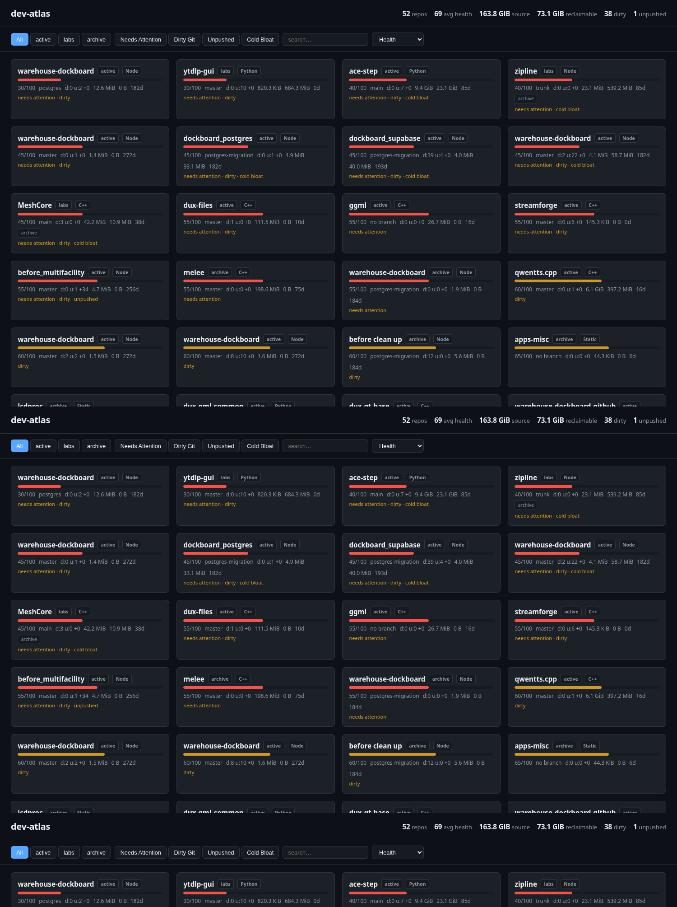

# dev-atlas

`dev-atlas` is a C++20 command center for a local development workspace. It scans
`~/development` (`active/`, `labs/`, `archive/`, including nested project groups),
reports per-repo git sync state, engineering health, and disk bloat, and serves a
dark-mode dashboard on `127.0.0.1:8090`.

The binary is a single static-linked C++20 executable built with CMake, using only
the C++ standard library and POSIX sockets. No third-party C++ dependencies.



## Features

- **Workspace scan:** discovers every project repo (git repos, nested groups, and
  plain static directories) in parallel, and reports branch, dirty/untracked
  counts, ahead/behind, GitHub remote, and last commit age.
- **Engineering health score (0-100):** README, AGENTS.md, .gitignore, 350-line
  source ceiling (top 3 largest files listed), hardcoded machine paths, and a
  gitleaks secret scan when the tool is available.
- **Disk bloat split:** separates source code from rebuildable bloat
  (`.venv`, `venv*`, `node_modules`, `build`, `target`, `out`, `.ruff_cache`,
  `.pytest_cache`) and plans safe reclamation of dormant bloat in untouched
  repos. `reclaim` is dry-run by default and never touches tracked or
  uncommitted source.
- **Lifecycle suggestions:** `labs/` projects that pass all checks are
  candidates for promotion to `active/`; cold projects untouched for 30+ days
  are candidates for `archive/`.
- **Dashboard:** fluid responsive dark-mode UI with KPI bar, bucket tabs,
  issue filters (needs attention, dirty git, unpushed, cold bloat), instant
  search, sorting, and an expandable audit drawer per repo. Running containers
  and their published ports are mapped back to the owning repo.

All displayed paths under `$HOME` are rendered as `~/...` so output and
screenshots never expose the absolute home directory.

## Commands

```bash
./build/dev_atlas scan                              # aligned table of the workspace
./build/dev_atlas scan --json                       # machine-readable JSON
./build/dev_atlas doctor <repo>                     # detailed audit of one repo
./build/dev_atlas reclaim                           # dry-run plan for dormant bloat
./build/dev_atlas reclaim --older-than 60           # only repos untouched 60+ days
./build/dev_atlas reclaim --apply                   # delete the planned bloat dirs
./build/dev_atlas report                            # writes out/latest.html
./build/dev_atlas serve --port 8090                 # dashboard + /api/scan.json
```

`DEV_ATLAS_HOME` overrides the workspace root (default `$HOME/development`).

## Build

```bash
cmake -B build && cmake --build build
```

Requires CMake 3.16+, a C++20 compiler (GCC 12+), and POSIX. Optional tools
picked up at runtime when present: `gitleaks` (secret scan), `podman`
(container mapping).

## Docker

Multi-stage build on `debian:bookworm-slim`; the runtime image contains only
the compiled binary and the dashboard template.

```bash
cp .env.example .env          # point DEV_ATLAS_HOST_HOME at your workspace
docker compose up --build     # or: podman compose up --build
```

The workspace is mounted read-only at `/workspace`. For rootless Podman, copy
`compose.override.yml.example` to `compose.override.yml` first (it carries the
Podman-only `userns_mode` option).

## Tests and checks

```bash
cmake -B build && cmake --build build
ctest --test-dir build --output-on-failure
clang-tidy -p build src/*.cpp
gitleaks detect --no-banner   # from the repo root
```

The test suite covers discovery, stack detection, git status, bloat split,
reclaim dry-run and apply, path collapsing, health scoring, and the JSON /
table / HTML renderers plus the HTTP server.

## Layout

```
include/dev_atlas/   shared data model and component contracts
src/                 common, scanner, reclaim, auditor, renderer, server, main
templates/           dashboard.html (dark-mode, responsive)
tests/               test_dev_atlas.cpp (plain stdlib harness, no framework)
out/                 rendered reports (gitignored)
```
